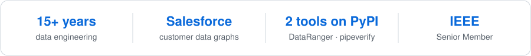

  

<h3 align="center">I build data platforms, and the checks that stop AI agents from quietly breaking them.</h3>

  <picture>
    <source media="(prefers-color-scheme: dark)" srcset="assets/stats-dark.svg">
    
  </picture>

  
  
  
  
  

I'm a Lead Member of Technical Staff at Salesforce, working on customer data graphs. Before that I
spent 15+ years building data platforms in banking, retail and healthcare, including principal data
engineering roles at Discover Financial Services and Capital One. I'm an IEEE Senior Member and an
IET Member, based near Chicago.

The question behind most of my work: **when an AI agent changes production data, how do you know
the change was right?** A green job and passing tests are not proof. I study that question, publish
on it, and build open-source tools for it.

---

### 🛠️ Open source

| Project | What it does | |
| :--- | :--- | :--- |
| **[DataRanger](https://github.com/akshaysharma1088/dataranger)** | Patrols your tables after data lands, finds what broke, and applies a fix only when it reconciles with the source system's own totals. Everything else goes to a person, with the evidence. Snowflake, dbt, DuckDB, GitHub Action, MCP. |  |
| **[pipeverify](https://github.com/akshaysharma1088/pipeverify)** | Checks a pipeline change before it merges. Compares a table before and after the change, and against its raw source, and returns pass, review or block. |  |
| **[dbt-dataranger](https://github.com/akshaysharma1088/dbt-dataranger)** | A dbt package that reconciles a model with the raw table it was built from, day by day. Catches a join that fans out or a unit change while every dbt test stays green. | dbt package |
| **[PipeMend](https://github.com/akshaysharma1088/pipemend)** | A benchmark of 64 broken pipelines repaired by LLM agents. Production-style monitors approved every harmful fix the agents made. | Benchmark |
| **[ETL-TransBench](https://github.com/akshaysharma1088/etl-transbench)** | A benchmark and agentic framework for translating legacy ETL into modern dataflows, with executable checks for each task. | Benchmark |

---

### 📄 Research

| Paper | Venue | |
| :--- | :--- | :--- |
| **Domain-Driven Data and AI Platforms** | *IET Software*, 2026 |  |
| **Bounded Contexts or Graph Communities? Partitioning Enterprise Knowledge Graphs for Governed Retrieval** | *IEEE CCWC 2027* |  [code](https://github.com/akshaysharma1088/governed-kg-retrieval) |
| **Fix or Page?** The PipeMend study of LLM agents repairing data pipelines | SSRN preprint |  |

More research code: [fraudrag](https://github.com/akshaysharma1088/fraudrag) (knowledge-graph RAG for financial fraud) and [bird-dissatisfaction-research](https://github.com/akshaysharma1088/bird-dissatisfaction-research) (detecting customer dissatisfaction mid-conversation). Full list on [Google Scholar](https://scholar.google.com/citations?hl=en&user=r3B6c_UAAAAJ).

---

### 🎤 Speaking

- **Invited keynote, TAIMMA 2027** (online, March 2027): *When AI Agents Touch Production Data: Lessons from Building and Verifying LLM-Driven Data Systems*
- **Conf42 Chaos Engineering 2026**: *Your Monitors Approved Every Bad Fix: What Happened When AI Agents Repaired 64 Broken Pipelines*
- Earlier talks at Dreamforce, The Economist and a Snowflake workshop. Topics and bookings on [Sessionize](https://sessionize.com/akshaysharma10/).

### ✍️ Writing

#3 [Top AI Writer on HackerNoon](https://hackernoon.com/c/ai/writers) (November 2026).

- [Benchmarking Claude Haiku, Sonnet, and Opus on 64 Broken Data Pipelines](https://hackernoon.com/benchmarking-claude-haiku-sonnet-and-opus-on-64-broken-data-pipelines) (HackerNoon)
- [How to Evaluate Snowflake Cortex Embedding Models for Enterprise Search](https://hackernoon.com/how-to-evaluate-snowflake-cortex-embedding-models-for-enterprise-search) (HackerNoon)
- More on [DZone](https://dzone.com/users/5620337/akshaysharma1088.html), [HackerNoon](https://hackernoon.com/about/akshaysharma10) and [dev.to](https://dev.to/akshaysharma10)

### 🤝 Reviewing and community

- Peer reviewer for *IEEE Access* and *IEEE IT Professional* (reviews recorded on [ORCID](https://orcid.org/0009-0009-5718-2187))
- Technical Program Committee, TAIMMA 2027
- Hackathon judge (RevolutionUC, LA Hacks and others), and mentor at the USC AI Hackathon and CodePath

### 🌄 Beyond engineering

Outside work, I travel with my family. We have visited all 64 US national parks: the original 63
by September 2026, finishing at Acadia, and the newest park a few weeks after it was designated.

---

  <a href="https://www.linkedin.com/in/akshay-sharma-1088/">LinkedIn</a> ·
  <a href="https://akshaysharma1088.github.io">Website</a> ·
  <a href="https://sessionize.com/akshaysharma10/">Book a talk</a> ·
  <a href="https://scholar.google.com/citations?hl=en&user=r3B6c_UAAAAJ">Google Scholar</a>
   
  Views here are my own.

