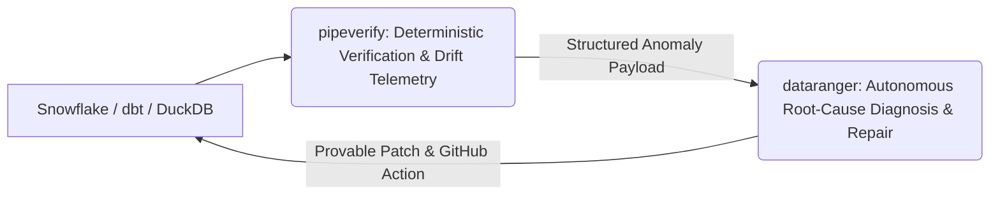

  

  
  
  
  

---

### Autonomous Data Pipeline Verification & Repair Ecosystem

**`pipeverify`** and **`dataranger`** form a closed-loop reliability architecture for enterprise lakehouses, Snowflake, DuckDB, and dbt pipelines:

  
  
  &nbsp;&nbsp;➔&nbsp;&nbsp;
  
  

| System | Architectural Role | Core Capabilities | Install |
| :--- | :--- | :--- | :--- |
| **[pipeverify](https://github.com/akshaysharma1088/pipeverify)** | **Stage 1: Verification & Telemetry** | Verifies that pipeline changes leave data provably right—not just the job green. Detects total-shift, schema drift, and invariant breaches across CSV, Parquet, Excel, and SQL sources. | `pip install pipeverify` |
| **[dataranger](https://github.com/akshaysharma1088/dataranger)** | **Stage 2: Autonomous Repair** | Open-source AI agent that consumes verification telemetry, fixes only what it can prove against the source, and routes ambiguous anomalies with evidence. Supports Snowflake, dbt, DuckDB, and MCP. | `pip install dataranger` |

---

### Research, Benchmarks & Open-Source Systems

| Focus Area | Project / Publication | Venue / Artifacts |
| :--- | :--- | :--- |
| **Enterprise Graph RAG** | *Partitioning Enterprise Knowledge Graphs for Governed Retrieval* | **IEEE CCWC 2027** (Accepted) |
| **Conversational AI Evaluation** | **[bird-dissatisfaction-research](https://github.com/akshaysharma1088/bird-dissatisfaction-research)** — Mid-dialogue customer dissatisfaction detection (BIRD, VADER, RoBERTa baselines) | Research Repository & Annotated Dataset |
| **Financial Graph RAG** | **[fraudrag](https://github.com/akshaysharma1088/fraudrag)** — Knowledge Graph-Augmented RAG for Financial Statement Fraud Detection | Open-Source Framework |
| **LLM Pipeline Benchmarks** | *Benchmarking Claude Haiku, Sonnet, and Opus on 64 Broken Data Pipelines* | **HackerNoon** Technical Benchmark |
| **Lakehouse & AI Architecture** | *From Support Transcripts to Trusted AI Agents: Snowflake, Apache Iceberg, Cortex AI & Neo4j* | **Medium** Architecture Deep-Dive |

* **Academic Peer Review & Mentorship:** Reviewer for *VLDB*, *IEEE Access*, *IEEE IT Professional*, *CAAI Transactions on Intelligence Technology*, and *Wiley* journals; Industry Mentor at *CodePath*.
